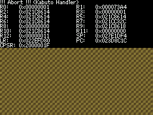
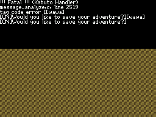
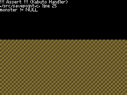

```
█   █     █          █            █   █              █ ██          
█  █      █          █            █   █              █  █          
█ █   ██  ███  █  █ ████  ██      █   █  ██  ███   ███  █  ██  █ ██
██      █ █  █ █  █  █   █  █     █████    █ █  █ █  █  █ █  █ ██  
█ █   ███ █  █ █  █  █   █  █     █   █  ███ █  █ █  █  █ ████ █   
█  █ █  █ █  █ █  █  █   █  █     █   █ █  █ █  █ █  █  █ █    █   
█   █ ███ ███   ███   ██  ██      █   █  ███ █  █  ███  █  ███ █   
```
##### or *KBT* for short
An error handler for Pokémon Mystery Dungeon: Explorers of Sky heavily based on the error handler present in main.srl, a debug build hidden in the game's files.

# What is this?
main.srl comes with a function to handle both fatal errors and assertion errors (you'll see this firsthand by just playing that ROM, as it crashes the moment you start 3F). It halts the game and manually writes a message into the top screen's VRAM, independent of any other systems the game relies on. This means that no matter what exactly breaks, the error message should (usually) still be able to display. Kabuto Handler ports that handler into the release build of the game (through [c-of-time](https://github.com/SkyTemple/c-of-time)), and automatically handles abort errors, while also allowing you to write your own errors and assertions in your own code.

KBT is **not** a replacement for any existing tools or debuggers. Rather, it's another tool for the debugging toolbox. It was originally made with the goal of mimicking [nds-bootstrap](https://github.com/DS-Homebrew/nds-bootstrap)'s [exception handler](https://github.com/DS-Homebrew/nds-bootstrap/blob/master/retail/cardenginei/arm9_igm/source/exception.c) so I could get the same debug information for an abort without having to get out my 3DS every time.
## Abort Handling


Catches data aborts, or really just about anything that would cause the game to freeze in `OSi_ExceptionHandler`. Displays all registers contents at the time of the error. Should work on anything that runs DS games and properly implements exception vectors (no exception vector means `OSi_ExceptionHandler` never runs.) This means that even the casual melonDS player can provide debugging information when they encounter an abort; no need to hook up GDB or try reproduce the error in a different emulator!
### KBT Abort Handling is supported on:
- **melonDS and derivatives**: This is the primary target.
- **Hardware (*via flashcart*)**
### KBT Abort Handling is *not* supported on:
- **Hardware (*via nds-bootstrap*)**: Doesn't seem to implement exception vectors, but doesn't need to! Provides its own abort handler that gives the same information that KBT would anyway, and then some.
- **no\$gba**: Doesn't implement exception vectors as it tries to handle errors on its own. *Most* of the time, no\$gba will at least give you a warning if something would have caused an abort, though I've found a few cases where something slips through the cracks.
- **DeSmuME and derivatives**:  Does not implement exception vectors as it tries to ignore errors whenever possible. You shouldn't be debugging on DeSmuME anyway.

## Fatal Errors


KBT catches calls to the vanilla `FatalError`, and constructs an error message similar to how vanilla would, down to the source file and line (though we don't know what the original source code looked like), but unlike vanilla, actually prints it in the way that debug builds like main.srl do.

## Custom Errors


Similar to fatal error handling, but you can write errors and assertions in your own code. `FatalError` expects a `prog_pos_info` with source code information, which would get inconvenient to write out every time, so KBT provides macros to skip `FatalError` and go straight to the handler:
* `KBT_ERROR(msg)` produces an error with a user-defined message.
* `KBT_ERRORFMT(fmt, ...)` produces an error with a user-defined format string and variables.
* `KBT_ASSERT(expr)` evaluates the boolean expression `expr`. If `expr` evaluates to true, nothing happens and the game continues as normal. If `expr` evaluates to false, an error is produced with `expr` as written in the source code printed as an error message.

KBT labels custom errors as "Error" and "Assert" to distinguish them from the "Fatal" label for vanilla `FatalError` calls.

Please note that KBT cannot handle *all* kinds of errors. There are some crashes where KBT will be unable to trigger due to their nature (such as infinite loops). However, the included features cover the most common issues.

# How to use

This is intended to be used with [c-of-time](https://github.com/SkyTemple/c-of-time).

To use this in your c-of-time repository:
- Copy the `patches`, `src`, `include`, and `symbols` folder to your `c-of-time` folder and merge with existing folders.

**OR**

- Add this repo as a submodule of your c-of-time repo (`git submodule add https://github.com/Chesyon/kabuto-handler modules/kabuto-handler`)

